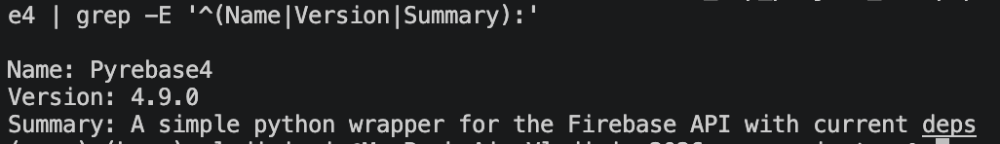
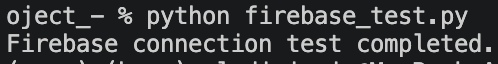
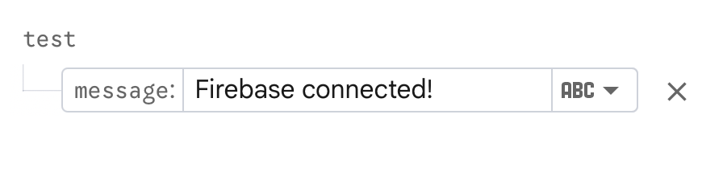

---
title: "Flask에서 Pyrebase4로 Firebase Realtime Database 연결하기"
date: 2026-11-24
---

## 1. 프로젝트 배경 및 목표

이음방은 이화여자대학교 학생들이 기존 이화인이 거주했던 자취방과 생활 정보를 공유하고, 다음 학생에게 방과 생활용품을 이어 줄 수 있도록 기획한 웹 서비스이다.

이음방 프로젝트에서는 회원 정보, 방 정보, 후기 등의 데이터를 관리하기 위해 Firebase Realtime Database를 사용한다. Flask 애플리케이션에서 Firebase에 접근하기 위해 Python 라이브러리인 `Pyrebase4`를 사용하였다.

Firebase와 Flask를 연결하는 과정에서는 필요한 라이브러리를 설치하고, Firebase 프로젝트의 설정 정보를 준비해야 한다. 또한 연결을 설정하는 것만으로는 실제 데이터 저장이 가능한지 알기 어렵기 때문에 별도의 테스트 과정도 필요하다.

이번 글의 목표는 Flask 프로젝트에 Pyrebase4를 설치하고 Firebase Realtime Database와 연결한 후, 간단한 테스트 데이터를 직접 저장하여 연결이 정상적으로 동작하는지 확인하는 것이다.

## 2. Pyrebase4 설치하기

먼저 터미널에서 프로젝트 폴더로 이동한 뒤 Python 가상 환경을 활성화한다.

macOS 환경에서는 다음 명령어를 사용하여 기존 가상 환경을 활성화할 수 있다.

```bash
source venv/bin/activate
```

가상 환경을 사용하면 프로젝트별로 필요한 Python 라이브러리를 독립적으로 관리할 수 있다.

그다음 Pyrebase4를 설치한다.

```bash
pip install pyrebase4
```

이음방 프로젝트의 `requirements.txt` 파일에는 Flask와 Pyrebase4가 등록되어 있기 때문에 다음 명령어를 사용하면 프로젝트에 필요한 라이브러리를 한 번에 설치할 수도 있다.

```bash
pip install -r requirements.txt
```

현재 프로젝트에서는 다음과 같이 필요한 패키지를 관리한다.

```text
Flask>=3.0,<4.0
pyrebase4
```

`requirements.txt`를 사용하면 팀원들이 동일한 프로젝트에서 필요한 라이브러리를 보다 편리하게 설치할 수 있다.

설치가 완료된 후 다음 명령어를 사용하여 Pyrebase4가 정상적으로 설치되었는지 확인한다.

```bash
pip show pyrebase4 | grep -E '^(Name|Version|Summary):'
```

위 명령어를 실행한 결과 Pyrebase4의 이름과 버전 정보가 정상적으로 출력되었다. 이를 통해 Pyrebase4 4.9.0 버전이 설치된 것을 확인할 수 있었다.



*그림 1. 터미널에서 Pyrebase4 설치 및 버전 확인*

이 단계의 목적은 아직 Firebase와 직접 연결하는 것이 아니라, Flask 프로젝트에서 Firebase를 사용할 수 있도록 필요한 Python 라이브러리를 준비하는 것이다.

## 3. Firebase 프로젝트 설정하기

Pyrebase4 설치가 완료되면 Firebase 프로젝트를 준비해야 한다.

먼저 [Firebase Console](https://console.firebase.google.com/)에 접속하여 새로운 프로젝트를 생성하거나 기존 프로젝트를 선택한다.

Firebase 프로젝트에서 다음과 같은 순서로 설정을 진행한다.

1. Firebase Console에서 프로젝트를 선택한다.
2. 왼쪽 메뉴에서 Build를 선택한다.
3. Realtime Database 메뉴로 이동한다.
4. 데이터베이스가 없다면 Create Database를 선택하여 생성한다.
5. 프로젝트 설정(Project settings)에서 웹 앱을 등록하고 Firebase 설정 정보를 확인한다.

Realtime Database와 Cloud Firestore는 서로 다른 데이터베이스 서비스이다. 이음방 프로젝트에서는 Pyrebase4의 `database()` 메서드를 사용하므로 Realtime Database를 선택한다.

Flask 애플리케이션에서 Firebase에 연결하려면 Firebase 프로젝트의 설정 정보가 필요하다. 이음방 프로젝트에서는 해당 정보를 별도의 JSON 파일로 관리하였다.

프로젝트 구조는 다음과 같다.

```text
project/
├── app.py
├── database.py
├── requirements.txt
└── authentication/
    └── firebase_auth.json
```

`firebase_auth.json` 파일에는 Firebase 프로젝트에 연결하기 위한 설정 정보가 저장된다.

설정 파일의 기본적인 형태는 다음과 같다.

```json
{
  "apiKey": "YOUR_API_KEY",
  "authDomain": "YOUR_PROJECT.firebaseapp.com",
  "databaseURL": "YOUR_DATABASE_URL",
  "projectId": "YOUR_PROJECT",
  "storageBucket": "YOUR_STORAGE_BUCKET"
}
```

위 코드는 예시이므로 실제로 연결할 때는 Firebase Console에서 확인한 프로젝트의 설정 값으로 변경해야 한다. 특히 `databaseURL`에는 생성한 Realtime Database의 실제 URL을 입력해야 한다.

이 설정 파일은 이후 `database.py`에서 읽어 Firebase를 초기화할 때 사용한다.

실제 프로젝트에서 사용하는 설정 파일이나 인증 관련 정보는 공개 블로그에 그대로 게시하지 않도록 주의해야 한다. 또한 Firebase Security Rules를 통해 데이터에 대한 읽기 및 쓰기 권한을 적절하게 관리해야 한다.

## 4. Flask와 Firebase 연결하기

Firebase 설정 파일을 준비한 후 `database.py`에서 해당 파일을 읽어 Firebase Realtime Database에 접근할 수 있도록 설정한다.

먼저 필요한 라이브러리를 불러온다.

```python
import json
import pyrebase
```

`json`은 JSON 형식의 설정 파일을 읽기 위해 사용하는 Python 기본 라이브러리이다. `pyrebase`는 Python에서 Firebase 서비스를 사용할 수 있도록 도와주는 라이브러리이다.

그다음 `DBhandler` 클래스의 생성자에서 `firebase_auth.json` 파일을 읽고 Firebase를 초기화한다.

```python
class DBhandler:
    def __init__(self):
        f = open("./authentication/firebase_auth.json")
        config = json.load(f)
        f.close()

        firebase = pyrebase.initialize_app(config)
        self.db = firebase.database()
```

`json.load()`는 JSON 파일에 저장된 Firebase 설정 정보를 Python에서 사용할 수 있도록 불러온다.

`pyrebase.initialize_app(config)`는 해당 설정 정보를 사용하여 Firebase 객체를 초기화한다.

마지막으로 `firebase.database()`를 통해 Firebase Realtime Database에 접근할 수 있는 객체를 생성하고 `self.db`에 저장한다.

이후 데이터 저장이나 조회가 필요한 경우 `self.db`를 사용할 수 있다.

예를 들어 현재 프로젝트에서는 다음과 같이 Firebase의 데이터를 불러올 수 있다.

```python
items = self.db.child("item").get().val()
```

`child("item")`은 데이터베이스에서 접근할 경로를 지정한다. `get()`은 해당 경로의 데이터를 가져오며, `val()`은 가져온 데이터의 실제 값을 반환한다.

현재 이음방 프로젝트의 백엔드는 개발 중이기 때문에 기존 데이터 구조를 새로운 방, 후기, 물려주기 기능에 맞게 수정할 예정이다. 하지만 Flask와 Firebase를 연결하는 기본 방식은 동일하게 사용할 수 있다.

## 5. 데이터 저장 테스트

Firebase 초기화가 정상적으로 이루어졌더라도 실제 데이터를 저장할 수 있는지 확인하는 과정이 필요하다.

따라서 Firebase 연결을 테스트하기 위해 `firebase_test.py`라는 별도의 Python 파일을 생성하였다.

이 파일은 기존 백엔드 코드에 영향을 주지 않도록 `app.py` 및 `database.py`와 같은 위치에 생성하였다.

```text
project/
├── app.py
├── database.py
├── firebase_test.py
└── authentication/
    └── firebase_auth.json
```

`firebase_test.py`에는 다음과 같이 코드를 작성하였다.

```python
from database import DBhandler

DB = DBhandler()

DB.db.child("test").set({
    "message": "Firebase connected!"
})

print("Firebase connection test completed.")
```

먼저 `database.py`에 정의된 `DBhandler` 클래스를 불러온다. `DBhandler()` 객체를 생성하면 앞에서 설정한 Firebase 객체를 사용할 수 있다.

`DB.db.child("test")`는 Firebase Realtime Database의 `test` 경로를 지정한다.

`set()` 메서드는 지정된 경로에 데이터를 저장하는 역할을 한다. 이번 테스트에서는 연결 상태를 확인하기 위해 `message`라는 키에 `Firebase connected!`라는 문자열을 저장하였다.

테스트를 진행할 때는 기존 프로젝트의 데이터와 충돌하지 않도록 사용하지 않는 별도의 경로를 선택해야 한다.

파일을 저장한 후 프로젝트 폴더에서 다음 명령어를 실행하였다.

```bash
python firebase_test.py
```

실행 후 터미널에 `Firebase connection test completed.` 메시지가 출력되었다.



*그림 2. firebase_test.py 실행 결과*

이를 통해 테스트 코드가 오류 없이 실행된 것을 확인하였다.

## 6. 실행 결과

테스트 코드가 정상적으로 실행된 후 실제 데이터가 저장되었는지 확인하기 위해 Firebase Console의 Realtime Database에 접속하였다.

Realtime Database의 Data 화면을 확인한 결과, `test` 경로 아래에 `message: Firebase connected!` 데이터가 정상적으로 저장된 것을 확인할 수 있었다.



*그림 3. Firebase Realtime Database에 저장된 테스트 데이터*

실행 결과를 통해 Flask 프로젝트에서 Pyrebase4를 이용하여 Firebase Realtime Database에 정상적으로 접근하고 데이터를 저장할 수 있다는 것을 확인하였다.

이번 테스트는 전체 백엔드 기능을 검증하는 것이 아니라 Firebase 초기화 및 데이터 저장 기능이 정상적으로 동작하는지 확인하기 위한 테스트이다.

테스트가 완료된 후에는 테스트용 데이터와 파일이 실제 프로젝트에 필요하지 않은 경우 삭제할 수 있다.

## 7. 배운 점

이번 실습을 진행하면서 Flask 애플리케이션과 Firebase가 어떤 방식으로 연결되는지 이해할 수 있었다.

처음에는 Firebase 설정 정보를 준비하고 Python 코드와 연결하는 과정이 복잡하게 느껴졌다. 하지만 Pyrebase4를 사용하면 Firebase를 초기화하고 데이터를 저장하거나 조회하는 기능을 비교적 간단하게 구현할 수 있다는 것을 알게 되었다.

또한 필요한 라이브러리를 `requirements.txt`로 관리하고 Firebase 설정 정보를 별도의 JSON 파일로 분리하는 것이 팀 프로젝트의 개발 환경을 관리하는 데 도움이 된다는 것을 배웠다.

특히 코드를 실행했을 때 오류가 발생하지 않는 것과 실제 데이터가 데이터베이스에 정상적으로 저장되는 것은 별도로 확인해야 한다는 점을 알게 되었다. 터미널의 실행 결과뿐만 아니라 Firebase Console에서 실제로 저장된 데이터까지 확인하는 것이 중요하다.

기존 백엔드 코드를 직접 수정하지 않고 별도의 테스트 파일을 만들어 연결을 확인하는 방법도 배울 수 있었다. 이러한 방식은 팀 프로젝트에서 다른 팀원의 작업에 영향을 주지 않으면서 특정 기능을 확인하는 데 도움이 된다.

이번에 확인한 Firebase 연결 방식을 바탕으로 앞으로 이음방 프로젝트의 회원 정보, 방 정보, 후기 및 물려주기 기능을 개발할 때 활용할 예정이다.
